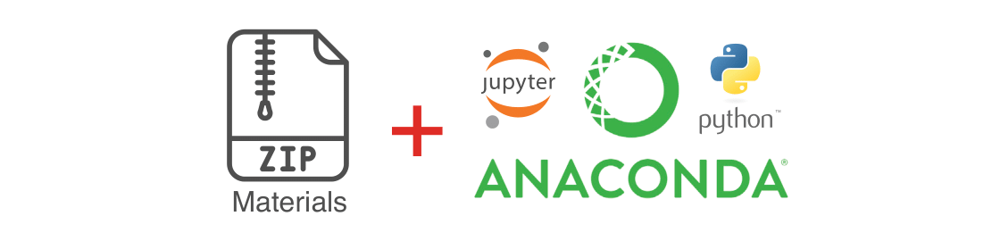

::: {.callout-note}

  **Set aside 15-20 minutes to install the software and download the materials before you start a workshop.**

:::

Before starting any of our Python workshops, it is necessary to complete 3 tasks. Depending on your internet speed, they may take a while.

1. download and unzip **class materials**
2. download and install **Positron**
3. download and install **uv**, which then installs Python and the workshop's packages



## Materials

Download class materials for your workshop:

* Python Introduction: <https://github.com/IQSS/dss-workshops/releases/latest/download/materials-python-intro.zip>
* Python Webscraping: <https://github.com/IQSS/dss-workshops/releases/latest/download/materials-python-webscrape.zip>

Extract materials from the zipped directory (Right-click => Extract All on Windows, double-click on Mac) and move them to your desktop.

It will be useful when you view the above materials for you to see the different file extensions on your computer. Here are instructions for enabling this:

* [macOS](https://support.apple.com/guide/mac-help/show-or-hide-filename-extensions-on-mac-mchlp2304/mac)
* [Windows](https://support.microsoft.com/en-us/windows/common-file-name-extensions-in-windows-da4a4430-8e76-89c5-59f7-1cdbbc75cb01)

## Software

We write and run Python in [Positron](https://positron.posit.co/), a free data science IDE from Posit (our R workshops use it too), and we let [uv](https://docs.astral.sh/uv/) install Python itself and the packages each workshop needs, so that everyone has the same setup. The versions these materials were last tested with:

* Positron version ****
* uv version ****, installing Python ****

### Positron

Download and run the installer for your system from [positron.posit.co/download](https://positron.posit.co/download).

### uv

* **macOS and Linux:** open the Terminal application, paste this line, and press enter; then close and reopen the Terminal.

  ```sh
  curl -LsSf https://astral.sh/uv/install.sh | sh
  ```

* **Windows:** open PowerShell, paste this line, and press enter; then close and reopen PowerShell.

  ```powershell
  powershell -ExecutionPolicy ByPass -c "irm https://astral.sh/uv/install.ps1 | iex"
  ```

Check it with `uv --version`, which should print a version number.

### Python and the packages

uv installs these per workshop, from the materials folder, so nothing you do here affects other Python projects on your computer:

1. Start Positron and go to `File -> Open Folder`; choose the workshop materials folder you unzipped (for the introduction, `python-intro`). If the interpreter picker at the top right suggests `Create Python Environment` or `Install Python`, dismiss it; `uv sync` in the next step does both.
2. Open a terminal inside Positron (`Terminal -> New Terminal`) and run:

   ```sh
   uv sync
   ```

   This installs Python  if you do not have it, and the packages listed in the folder's `pyproject.toml`, into a `.venv` folder inside the materials folder (`python-intro/.venv`). It takes a minute or two the first time.

::: {.callout-tip}

**Success? The interpreter shown at the top right of Positron's window should be the Python from `.venv` (click it and choose that one if not). Open the BLANK notebook (for the introduction, `intro_BLANK.ipynb`), add a cell with the `+ Code` button, type `1 + 1` in it, and press `Shift+Enter`: if `2` appears under the cell, you are ready. You can delete that cell afterwards.**

:::

::: {.callout-important}

**If you are having any difficulties with the installation, use the Request help button at the top of the page.**

:::

## Notebooks in Positron

We run the workshop code in Jupyter notebooks (`.ipynb` files): documents that combine text, code, and the code's output. Positron opens them directly in its notebook editor; there is nothing else to install.

1. In the Explorer on the left, click a notebook (the one with `BLANK` in its name is the one to type along in).
2. The kernel picker at the top right should show the Python from `.venv`; choose it if it does not.
3. A notebook is a list of *cells*. To execute a cell, select it and press `Shift+Enter`; to add one, use the `+ Code` or `+ Markdown` button.

