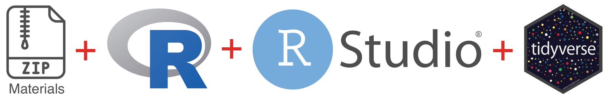
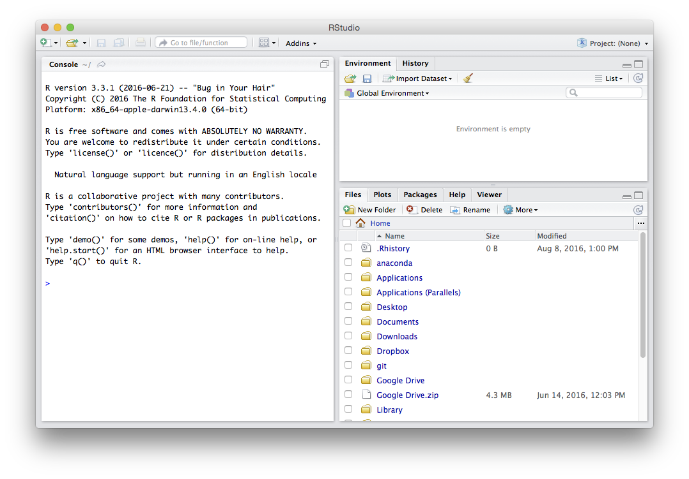
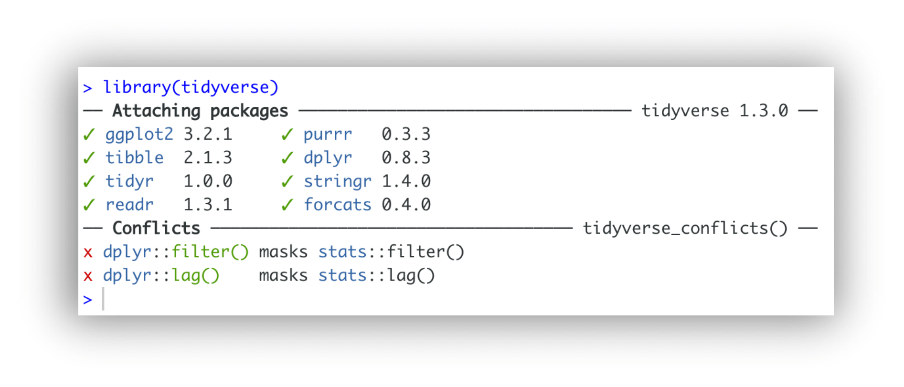

::: {.callout-note}

  **Set aside 15-20 minutes to install the software and download the materials before you start a workshop.**

:::

Before starting any of our R workshops, it is necessary to complete 4 tasks. Depending on your internet speed, they may take a while. 

1. download and unzip **class materials**
2. download and install **R**
3. download and install **Positron**
4. install the `tidyverse` suite of **R packages**

## Materials

Download class materials for your workshop:

* R Introduction: <https://github.com/IQSS/dss-workshops/releases/latest/download/materials-r-intro.zip>
* R Regression Models: <https://github.com/IQSS/dss-workshops/releases/latest/download/materials-r-models.zip>
* R Graphics: <https://github.com/IQSS/dss-workshops/releases/latest/download/materials-r-graphics.zip>
* R Data Wrangling: <https://github.com/IQSS/dss-workshops/releases/latest/download/materials-r-wrangling.zip>

Extract materials from the zipped directory (Right-click -> Extract All on Windows, double-click on Mac) and move the extracted folder (`r-intro`, `r-models`, `r-graphics`, or `r-wrangling`) to your desktop. On Windows, Extract All puts this folder inside another folder named after the zip file; it is the inner folder that you move and later open in Positron. 

It will be useful when you view the above materials for you to see the different file extensions on your computer. Here are instructions for enabling this:

* [macOS](https://support.apple.com/guide/mac-help/show-or-hide-filename-extensions-on-mac-mchlp2304/mac)
* [Windows](https://support.microsoft.com/en-us/windows/common-file-name-extensions-in-windows-da4a4430-8e76-89c5-59f7-1cdbbc75cb01)

## Software

You must install **both R and Positron**, the IDE we use for R and for Python alike (if you already use RStudio and prefer it, everything in these workshops works there too). It is also important that you have the latest version of each. These materials were last tested with:

* R version ****
* Positron version ****

**macOS:** 

1. Install R by downloading and running the .pkg file for your Mac (Apple silicon or Intel) from [CRAN](https://cran.r-project.org/bin/macosx/). 
2. Install Positron by downloading and running the macOS installer from [positron.posit.co](https://positron.posit.co/download).

**Windows:** 

1. Install R by downloading and running the .exe installer from [CRAN](https://cran.r-project.org/bin/windows/base/).
2. Install Positron by downloading and running the Windows installer from [positron.posit.co](https://positron.posit.co/download). Positron also needs the latest Visual C++ Redistributable, which is linked under Prerequisites on the same page.

**Linux:** 

1. Install R by downloading the binary files for your distribution from [CRAN](https://cran.r-project.org/bin/linux/). Or you can use your package manager (e.g., for Debian/Ubuntu run `sudo apt-get install r-base` and for Fedora run `sudo dnf install R`).
2. Install Positron [for your distribution](https://positron.posit.co/download).

::: {.callout-tip}

**Success? After both installations, please launch Positron. It finds your R installation by itself; if all went well you should see a window similar to this, with an R console at the bottom (the R version reported may be newer):**

:::

 
::: {.callout-important}

**If you are having any difficulties with the installations or your Positron window does not look like this one, use the Request help button at the top of the page.**

:::

## Installing the `tidyverse`

We will use the `tidyverse` suite of packages throughout these R workshops.
Here are the steps for installation:

1.  **Launch an R session within Positron**

    On Windows, click the start button and search for Positron then click on it. On Mac,
    Positron will be in your Applications folder --- double click on it. The Console at the
    bottom of the window is an R session.

2.  **Install `tidyverse`**

    In the Console pane at the bottom of the window, at the command prompt (`>`) type the following and press enter:

    `install.packages("tidyverse")`

    *  If a choice appears that says something like: 
    
       `Do you want to install from sources the package which needs compilation?` 
    
       type `No` in the console.
    
    *  If you are running Windows OS, you may see a message that says: 
    
       `WARNING: Rtools is required to build R packages, but is not currently installed.`
    
       You can safely ignore this warning.

    A number of messages will scroll by, and there will be a long minute or two
    pause where nothing appears to happen (but the installation is actually occurring).
    At last, the output parade should end with a message like:

    `The downloaded source/binary packages are in....`

3.  **Check that installation was successful**

    We can check that `tidyverse` has installed correctly by connecting it to our current R session. 
    Type the following in the console at the command prompt (`>`) and press enter:

    `library(tidyverse)`

    ::: {.callout-tip}

    **Success? If so, you should see the following message in the console (note that the version numbers reported may be newer):**

    :::

    

    ::: {.callout-important}

    **If you do not see this message and encounter an error --- try troubleshooting this in the next section.**

    :::

### Troubleshooting `tidyverse` installation

Sometimes, you may run into problems installing the `tidyverse` suite of packages. Here are some commonly encountered errors and suggestions for how to fix them:

1.  **`tidyverse` is not available for R version...**
    * Solution: make sure you have the latest versions of both R and Positron (these materials were last tested with R  and Positron ).

2.  **there is no package `rlang`...**
    * Solution: run this command in the console at the command prompt (`>`):
    * `install.packages("dplyr")` 
    * If a choice appears that says something  like `Do you want to install from sources the package which needs compilation?`, type `No` in the console.

3.  **there is no package `broom`...** 
    * Solution: run these commands in the console at the command prompt (`>`), **in this order**:
    * `install.packages("backports")`
    * `install.packages("broom")`
    * `install.packages("tidyverse")`
    * If a choice appears at any point that says something like `Do you want to install from sources the package which needs compilation?`, type `No` in the console.

4.  **rlang and/or broom still do not work**
    * Solution: load individual packages that we need from the `tidyverse` suite, by running the following commands in the console at the command prompt (`>`):
    * `library("dplyr")`    to filter, select, arrange and summarise data
    * `library("ggplot2")`  modern data visualization
    * `library("readr")`    to load CSV data files
    * `library("tidyr")`    to reshape data frames

::: {.callout-important}

**If you have still not successfully installed `tidyverse` (or at least `dplyr`, `ggplot2`, `readr`, and `tidyr`) after troubleshooting, use the Request help button at the top of the page. Without these packages, you will not be able to follow along with the workshop materials.**

:::

## Packages for the intermediate workshops

The `tidyverse` is all you need for [R Introduction](intro.qmd). The other
three R workshops each use a few extra packages. Install them the same way,
in the Console at the `>` prompt --- either now, or before you start that
workshop:

* **R Regression Models**

    `install.packages(c("lme4", "lmerTest", "marginaleffects", "emmeans", "multilevel"))`

* **R Graphics**

    `install.packages(c("scales", "ggrepel"))`

* **R Data Wrangling** needs nothing beyond the `tidyverse`.

::: {.callout-tip}

**Success? Load one of them to check, for example `library(lme4)`. If it
returns you to the `>` prompt with no error, it is installed.**

:::

## Installing `rmarkdown` (optional)

We can also install the `rmarkdown` package, which Quarto uses to
render the `.qmd` files in the materials into a formatted document
that combines text and code. Installing this package is optional and will not affect
your ability to follow along with the workshop.

1.  **Install `rmarkdown`**

    At the command prompt in the console (`>`), please run the following command and press enter:

    `install.packages("rmarkdown")`

    then wait for the stream of messages to end with:

    `The downloaded source/binary packages are in....`

2.  **Check that installation was successful**

    We can check that `rmarkdown` has installed correctly by connecting it to our R session.
    Type the following in the console at the command prompt (`>`) and press enter:

    `library(rmarkdown)`

    ::: {.callout-tip}

    **Success? If so, in the console you should see just a command prompt (`>`) with no messages to the right of it.**

    :::

    ::: {.callout-important}

    **If you see error or warning messages after the command prompt, the installation was not successful.**

    :::

If all the above steps have been completed successfully, you should now
be ready to start your workshop. **If you ran into any problems, use the
Request help button at the top of the page.**

